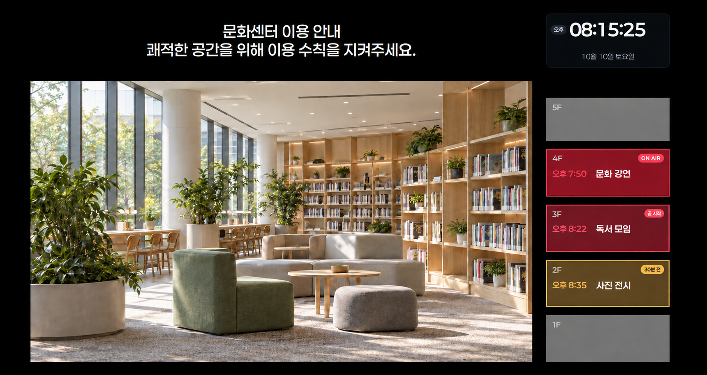
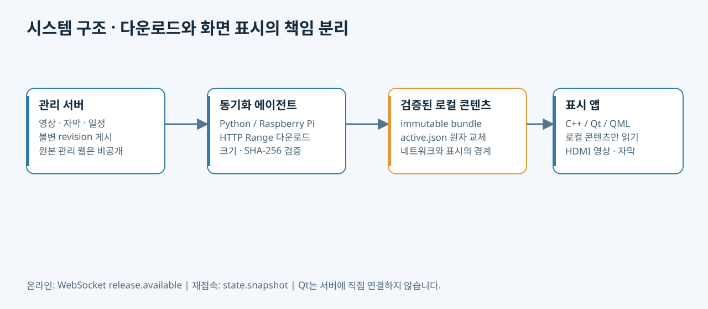

# 스마트 디지털 사이니지

서버에서 영상·자막·행사 일정을 배포하고 Raspberry Pi의 C++/Qt 화면에 표시하는 시스템입니다. Python 에이전트가 콘텐츠를 내려받아 검증하고, Qt 클라이언트는 준비된 로컬 파일을 읽어 재생합니다.

- 개발 기간: 2025.12 ~ 2026.03
- 담당: 콘텐츠 배포·동기화, 파일 검증·활성화, C++/Qt 화면 개발
- 기술: C++20, Qt 6/QML, Qt Multimedia, Python, WebSocket, HTTP, Linux

## 화면



| 영역 | 기능 |
|---|---|
| 영상 | 로컬 재생 목록의 미디어 표시 |
| 자막 | 영상과 별도로 공지 문구 표시 |
| 시계 | 현재 시각과 날짜 안내 |
| 층별 일정 | 행사명·시작 시각과 진행 중, 시작 임박, 예정 상태 표시 |

## 시스템 구조



서버는 콘텐츠를 게시하고, 에이전트는 기기의 파일 상태를 관리합니다. Qt는 네트워크 연결 대신 로컬 콘텐츠를 읽습니다.

1. 서버가 새 콘텐츠를 게시하면 WebSocket으로 기기에 알립니다.
2. 에이전트가 manifest와 파일을 HTTP로 내려받습니다.
3. 파일 크기와 SHA-256을 확인한 뒤 `active.json`을 교체합니다.
4. Qt가 새 콘텐츠를 읽고 영상·자막·일정을 갱신합니다.

[구조와 콘텐츠 형식](docs/architecture.md)

## 주요 구현

### 다운로드가 끝난 뒤 화면에 반영

다운로드 중인 파일을 재생 화면에서 바로 읽지 않도록 staging과 활성 콘텐츠를 분리했습니다. 검증을 통과한 묶음만 활성화하고, 실패하면 마지막 정상 콘텐츠를 유지합니다.

- [`ReleaseInstaller`](src/smart_signage/agent.py): 다운로드, 검증, 활성 포인터 교체
- [`ActiveBundleWatcher`](display-client/src/active_bundle_watcher.cpp): 파일 변경 감지와 콘텐츠 검사

### 재접속과 배포 순서 처리

연결이 끊겼던 기기는 재접속 시 `state.snapshot`으로 현재 배정된 콘텐츠를 받습니다. 실시간 변경 알림인 `release.available`도 같은 처리 경로를 사용합니다.

콘텐츠 버전인 revision과 배정 순서인 generation을 나눠, 늦게 끝난 이전 다운로드가 새 배포를 덮어쓰지 않도록 했습니다. [`SyncAgent`](src/smart_signage/agent.py)에서 최신 목표를 관리합니다.

### 재생 흐름과 일정 표시

자막·일정은 갱신하되 재생 목록은 현재 영상이 끝난 뒤 바꿉니다. C++에서 재생 상태와 일정 상태를 계산하고 QML에서 화면을 구성합니다.

- [`DisplayController`](display-client/src/display_controller.cpp): 콘텐츠 적용과 재생 상태
- [`schedule_projection.cpp`](display-client/src/schedule_projection.cpp): 날짜·반복 일정과 진행 상태
- [`Main.qml`](display-client/qml/Main.qml): 영상, 자막, 시계, 일정 화면

## 디렉터리

```text
src/smart_signage/  콘텐츠 생성, 파일 관리, 기기 동기화
display-client/    C++/Qt 표시 앱, JSON 스키마, Qt 테스트
tests/             Python 동기화·활성화 테스트
tools/             로컬 예제 서버·에이전트, 샘플 콘텐츠 생성
docs/              구조, 실행 방법, 코드 안내
```

## 빌드와 테스트

Python 3.11 이상과 uv가 필요합니다.

```bash
uv sync --dev --frozen
uv run pytest -q
uv run ruff check --config pyproject.toml src tools tests
```

Qt 코어 테스트에는 Qt 6.4 이상(Core, Gui, Test), CMake, Ninja가 필요합니다.

```bash
uv run python tools/make_sample.py --contract-only
cmake -S display-client -B build -G Ninja -DSIGNAGE_BUILD_APP=OFF -DBUILD_TESTING=ON
cmake --build build --parallel
ctest --test-dir build --output-on-failure
```

`--contract-only`는 영상 재생 없이 콘텐츠 형식을 검사하는 샘플을 만듭니다. GUI 실행에는 Qt Quick/QML과 Multimedia가 추가로 필요합니다.

[전체 앱 실행 방법](docs/local-run.md) · [테스트 결과](docs/validation.md)

## 저장소 범위

현장 운영 코드에서 콘텐츠 동기화와 Qt 표시 부분을 분리해 정리했습니다. 관리 웹 전체와 운영 설정은 제외했으며, `tools/demo_server.py`는 로컬 테스트용 서버입니다. 기기별 영상 디코딩과 장시간 재생은 코어 테스트와 별도로 확인해야 합니다.

[코드 안내](docs/code-map.md) · [소스 정리 내역](docs/provenance.md) · [남은 과제](docs/limitations.md)
