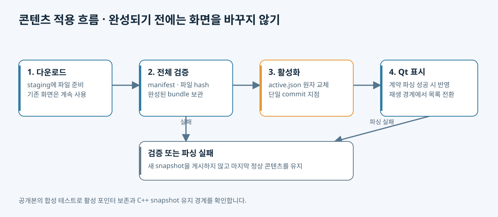

# 구조와 콘텐츠 계약

## 세 가지 책임

| 경계 | 책임 | 전달 계약 |
|---|---|---|
| 관리 서버 | 유효성 확인, revision 게시, 기기별 목표 배정 | manifest, 파일, revision/generation |
| 동기화 에이전트 | 전송·재시도·검증·활성화 | 불변 bundle과 active.json |
| Qt 표시 앱 | 로컬 계약 검사, 영상·자막·일정·화면 출력 | 화면과 내부 재생 상태 |

전체 관리 서버는 원본 프로젝트의 구성입니다. 공개본은 콘텐츠 compiler와 동기화 코드를 포함하며, 서버 wire contract는 loopback harness로 확인합니다.

## revision과 generation

`revision`은 콘텐츠 묶음, `generation`은 기기 배정 순서입니다. 이전 콘텐츠로 돌아가더라도 새 generation으로 배정할 수 있습니다. 에이전트는 더 오래된 generation을 무시합니다. 온라인 이벤트와 재접속 snapshot은 `DesiredRelease.from_message()`와 `_offer_desired()`를 거칩니다.

재연결은 backoff, 일시적인 전송 실패는 별도 retry delay를 사용합니다. 무결성 오류는 네트워크 오류처럼 무한 재시도하지 않습니다.

## 다운로드와 활성화



```text
releases/.<bundle-id>.staging/   다운로드 중
  ↓ manifest + file size/SHA-256 확인
releases/<bundle-id>/           완료된 불변 콘텐츠
  ├─ .manifest.json / .complete
  ├─ bundle.json
  ├─ display.json / playlist.json / schedule.json / subtitle.json
  └─ media/...
active.json                    현재 사용할 bundle 포인터
```

`ReleaseInstaller.prepare()`는 manifest를 먼저 검증하고 파일 다운로드·검증을 완료합니다. `.complete` 기록과 fsync 후 디렉터리를 완성 상태로 이동합니다. `activate()`는 준비된 경로를 확인하고 `active.json`을 원자적으로 교체합니다. 완성 전 실패하면 기존 포인터는 그대로입니다.

활성화 직전 최신 목표 검사와 로컬 commit 사이에는 `await`가 없습니다. 새 이벤트가 두 단계 사이에 끼어드는 것을 막기 위한 경계입니다.

Qt는 활성 포인터의 상위 디렉터리를 감시합니다. 파일이 원자 교체되면 inode가 달라질 수 있기 때문입니다. 200ms debounce 후 `BundleParser::loadActive()`가 성공한 snapshot만 전달합니다. 대용량 영상 hash는 에이전트가 검증하며 GUI thread에서 재계산하지 않습니다. Qt는 identity, 경로 경계, JSON 계약을 검사합니다. 이 설계만으로 frame time 개선 수치를 주장하지 않습니다.

## 표시와 재생 경계

`DisplayController::acceptSnapshot()`은 자막·일정·표시 설정을 갱신합니다. 재생 중이면 playlist는 pending으로 보관하고 현재 영상의 끝에서 적용합니다. QML은 C++ 속성을 바인딩하고 미디어 상태를 controller에 전달합니다. 네트워크·인증을 직접 다루지 않습니다.

Linux 화면 선택 코드는 DRM/EDID와 Qt 화면 정보를 함께 확인합니다. 실제 HDMI·디코더·Wayland 동작은 별도 실기기 검증 대상입니다.
